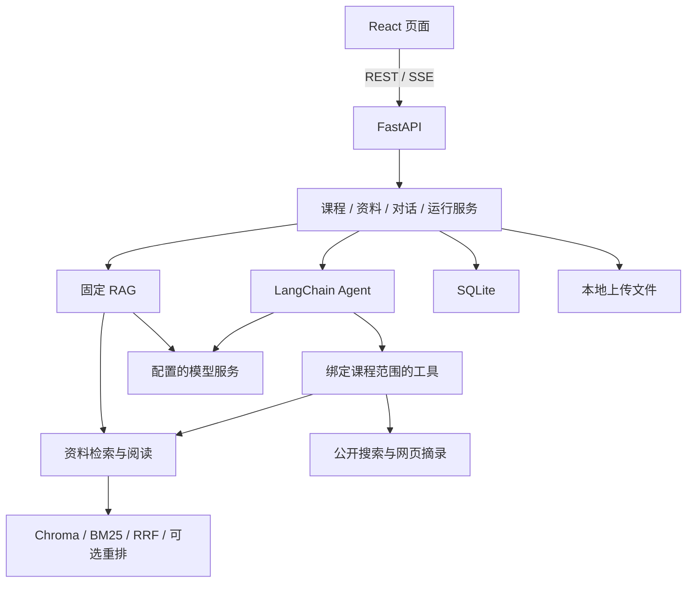

# 架构与模块

## 运行形态

一个源码仓库、独立 React 前端和单进程 FastAPI 后端。Agent、检索、索引任务与业务服务均在后端中协作。

## 职责

| 目录 | 职责 |
| --- | --- |
| `frontend/src/features/` | 课程、资料和学习对话页面 |
| `frontend/src/api/` | HTTP 和 SSE 客户端 |
| `backend/app/api/` | 路由、输入验证与 HTTP 错误 |
| `backend/app/services/` | 业务事务、状态变更与运行事件 |
| `backend/app/repositories/` | 数据访问与历史查询 |
| `backend/app/qa/` | Agent、RAG、证据核对、运行调度和用量记录 |
| `backend/app/retrieval/` | 解析、索引、混合召回、重排和网页工具 |
| `backend/app/jobs/` | 自动建库、清理与恢复 |
| `backend/app/db/` | SQLAlchemy 数据模型、连接 |
| `backend/app/core/` | 配置、模型工厂与并发锁 |
| `backend/migrations/` | Alembic 数据库迁移 |

## 数据与一致性

SQLite 保存课程、资料版本、原文片段、对话、运行事件和引用。Chroma 保存向量，课程与嵌入配置共同决定集合。资料当前可用版本由 SQLite 决定，未发布向量不参与检索。

替换资料时先处理新版本，完整成功后切换可用版本；失败则继续使用当前版本。删除业务记录时同时保存清理任务，后台回收原件和向量。

引用独立保存回答当时的内容，删除或替换原资料不会改写既有回答依据。只有已完成问答进入后续上下文；中止和失败内容保留展示。

## 运行控制

后端绑定课程范围，模型不能传入任意存储路径或选择其他课程。每段对话最多一个活动运行，工具次数、文本量与时间受限。SSE 读取持久化事件，断线重连不会重复调用模型。重启将未完成任务标为中断。

课程隔离属于业务范围控制，应用目前没有用户身份和多用户授权。使用限制见 [SECURITY.md](../SECURITY.md)。
