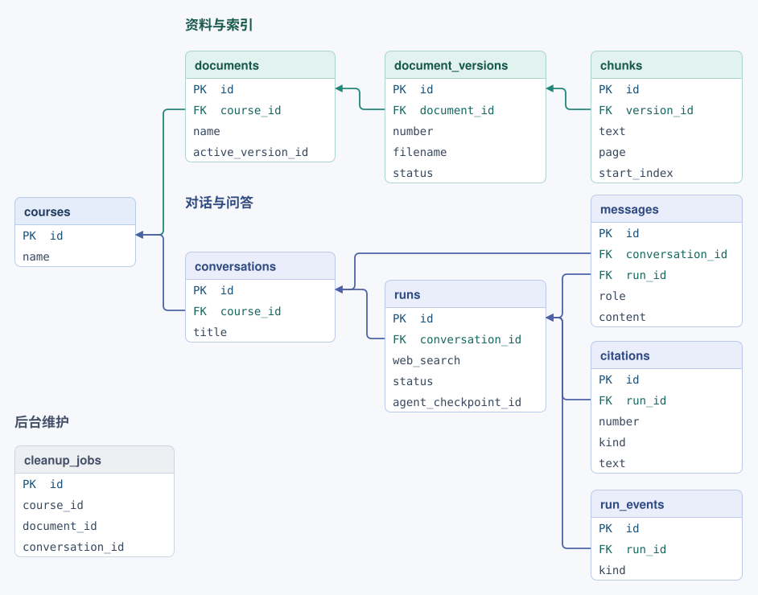

# 数据库关系图

这张图概览应用管理的 SQLite 表。箭头从子表的 **FK（外键）所在行**出发，指向父表的 **PK（主键）所在行**。对每条关系，子表记录关联一条父表记录，父表记录可以关联零到多条子表记录。

## 应用维护的引用

| 字段 | 指向 | 用途 |
| --- | --- | --- |
| `documents.active_version_id` | `document_versions.id` | 指向当前发布的版本，首次发布前为空。 |
| `citations.document_id`、`version_id`、`chunk_id` | `documents.id`、`document_versions.id`、`chunks.id` | 课程引用记录回答当时的来源。即使对应资料已删除，仍可用 `citations.text` 显示摘录。网络引用另存 URL。 |
| `cleanup_jobs.course_id`、`document_id`、`conversation_id` | `courses.id`、`documents.id`、`conversations.id` | 记录后台清理的目标范围。目标记录删除后，任务仍可处理原件、向量或 Agent 检查点。 |
| `runs.agent_checkpoint_id` | LangGraph 独立 SQLite 文件中的检查点 | 记录成功完成的 Agent 运行提交的检查点，供同一对话续接。 |

Chroma 单独存储课程资料的向量，业务 SQLite 保存片段正文和来源位置。

## 维护方式

在 draw.io 中打开 `database-erd.drawio.svg`，可直接编辑表、字段和连线。修改后导出为 SVG，勾选「包含图表副本」并覆盖该文件，GitHub 会显示最新版本。表、主外键、图中核心字段或应用引用发生变化时，在同一次提交更新图和说明。完整字段及约束见 [SQLAlchemy 模型](../backend/app/db/models.py)和 [Alembic 迁移](../backend/migrations/versions/)。
